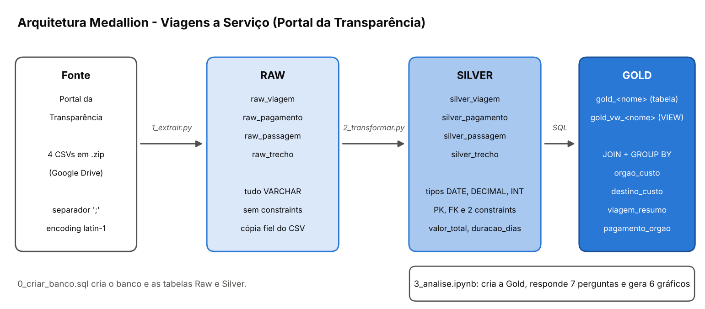

# Pipeline Medallion - Viagens a Serviço (Portal da Transparência)

Projeto Avaliativo do Módulo 1 (Semana 13) - Análise de Dados com Python, SCTECH, Turma T6.

Pipeline de ETL em **Python + MySQL** que baixa os dados públicos de *Viagens a Serviço* do Portal da Transparência
(6 meses de 2025), organiza em três camadas (**Raw → Silver → Gold**) e responde 7 perguntas de negócio com SQL,
tabelas e gráficos.

## 1. Qual problema o projeto resolve

O Portal da Transparência publica os gastos do governo federal com viagens em arquivos CSV soltos: números com vírgula
decimal, datas em texto, registros repetidos e nenhuma relação declarada entre os arquivos. Do jeito que vêm, não dá
para perguntar "quanto cada órgão gastou?" ou "qual o meio de transporte mais usado?".

O projeto automatiza o caminho do CSV até a resposta:

1. baixa e carrega os dados sem alterá-los (Raw);
2. limpa, converte os tipos e cria as relações entre as tabelas (Silver);
3. agrega os dados para análise e responde às perguntas com gráficos (Gold).

### Perguntas de negócio

| # | Pergunta | Camada de origem |
|---|---|---|
| 1 | Quais os 5 órgãos com maior custo total? | Gold |
| 2 | Quais os 3 destinos com maior custo médio por viagem? | Gold |
| 3 | Qual a viagem de maior duração e seu custo total? | Gold |
| 4 | Qual o tipo de pagamento com maior valor médio? | Silver (SQL direto) |
| 5 | Qual o meio de transporte mais usado nos trechos? | Silver (SQL direto) |
| 6 | Qual UF de destino aparece em mais trechos? | Silver (SQL direto) |
| 7 | Qual órgão pagou mais no total? | Gold |

## 2. Técnicas e tecnologias

- **Python 3.11+**, **pandas** (leitura dos CSVs em blocos), **mysql-connector-python** (conexão e carga em lote),
  **gdown** (download automático do Google Drive), **matplotlib** (gráficos) e **Jupyter** (notebook de análise).
- **MySQL 8** (usa `CHECK`, que exige a versão 8.0.16 ou superior).
- **Arquitetura Medallion**, com uma etapa por arquivo, executados na ordem numérica:



| Camada | O que contém | Como é criada |
|---|---|---|
| **Raw** | 4 tabelas `raw_*`, todas `VARCHAR`, sem constraints, cópia fiel do CSV (inclui colunas que a Silver não usa) | `1_extrair.py` |
| **Silver** | 4 tabelas `silver_*` com tipos corretos (`DATE`, `DECIMAL`, `INT`), PK, FK e 2 constraints por tabela | `0_criar_banco.sql` (estrutura) e `2_transformar.py` (carga) |
| **Gold** | Agregações com `JOIN` + `GROUP BY`, criadas como **tabela** (`gold_*`) e como **VIEW** (`gold_vw_*`) | `3_analise.ipynb` |

### Estrutura do repositório

```
.
├── 0_criar_banco.sql      # cria o database e as tabelas Raw e Silver
├── 1_extrair.py           # download do .zip e carga na Raw
├── 2_transformar.py       # limpeza, tipagem e carga na Silver
├── 3_analise.ipynb        # camada Gold, 7 perguntas e 6 gráficos
├── banco.py               # funções de conexão e inserção em lote
├── config.py              # caminhos, credenciais (lidas do .env) e arquivos de dados
├── .env.example           # modelo das credenciais (copie para .env)
├── requirements.txt       # dependências
└── docs/
    └── arquitetura_medallion.png
```

### Modelagem da Silver

| Tabela | Chave primária | Chave estrangeira | Constraints |
|---|---|---|---|
| `silver_viagem` | `id_viagem` | - | `NOT NULL` em `nome_orgao_superior`; `CHECK valor_diarias >= 0` |
| `silver_pagamento` | `id_pagamento` (auto) | `id_viagem` → `silver_viagem` | `CHECK valor >= 0`; `NOT NULL` em `tipo_pagamento` |
| `silver_passagem` | `id_passagem` (auto) | `id_viagem` → `silver_viagem` | `CHECK valor_passagem >= 0`; `CHECK taxa_servico >= 0` |
| `silver_trecho` | `id_trecho` (auto) | `id_viagem` → `silver_viagem` | `CHECK numero_diarias >= 0`; `UNIQUE (id_viagem, sequencia_trecho)` |

### Regras de negócio definidas neste projeto

O documento do projeto não traz as fórmulas, então as regras abaixo foram definidas por mim:

- **`valor_total = valor_diarias + valor_passagens + valor_outros_gastos - valor_devolucao`**.
  Valor ausente conta como zero na soma.
- **`duracao_dias = data_fim - data_inicio + 1`**, ou seja, o dia da ida e o da volta contam.
  Uma viagem de 1 a 3 do mês dura 3 dias. Se faltar uma data ou se a data final for anterior à inicial, fica `NULL`.
- **Valores inválidos:** valor negativo, fora do formato ou grande demais para a coluna vira `NULL` na Silver.
- **Registros órfãos:** pagamento, passagem ou trecho sem viagem correspondente é descartado, para respeitar a FK.
  A `silver_viagem` é carregada antes das tabelas filhas.
- **Duplicidades:**
  - `viagem` e `trecho` têm chave única, então a repetição da chave é descartada (mantém a primeira).
  - `pagamento` e `passagem` não têm identificador no CSV; uma linha **100% idêntica** a outra é tratada como duplicidade e
    mantida uma única vez. Limitação: dois pagamentos legítimos e idênticos não podem ser distinguidos de uma repetição.
- **Destinos:** o campo `destinos` lista várias cidades separadas por vírgula, muitas vezes repetidas. Na Pergunta 2,
  cada cidade é um destino e a viagem entra no cálculo de todas as cidades que visitou. "Informações protegidas por sigilo"
  não é um lugar e fica fora do ranking. Só entram destinos com **pelo menos 30 viagens**, para uma viagem isolada não
  distorcer a média.

### Resultado da carga (execução real)

| Tabela Silver | Linhas | Observação |
|---|---:|---|
| `silver_viagem` | 341.860 | - |
| `silver_pagamento` | 568.811 | 38.105 linhas idênticas descartadas |
| `silver_passagem` | 167.210 | 50 linhas idênticas descartadas |
| `silver_trecho` | 763.349 | - |

## 3. Como executar

Pré-requisitos: **Python 3.11+**, **MySQL 8** em execução e **Git**. Os comandos abaixo são para o PowerShell
(Windows). No Linux/macOS, troque a ativação do ambiente por `source .venv/bin/activate`.

1. **Clone o repositório e entre na pasta**

   ```powershell
   git clone https://github.com/paulotavaresanalytics/Projeto-Avaliativo-Modulo1-Paulo-Gomes.git
   cd Projeto-Avaliativo-Modulo1-Paulo-Gomes
   ```

2. **Crie o ambiente virtual e instale as dependências**

   ```powershell
   python -m venv .venv
   .\.venv\Scripts\Activate.ps1
   pip install -r requirements.txt
   ```

3. **Configure as credenciais do banco.** Copie o modelo e edite o `.env` com a sua senha do MySQL
   (o `.env` não vai para o Git):

   ```powershell
   Copy-Item .env.example .env
   notepad .env
   ```

4. **Crie o banco e as tabelas** (Fase 0). O script pode ser repetido: ele recria tudo.

   ```powershell
   mysql -u root -p --default-character-set=utf8mb4 -e "source 0_criar_banco.sql"
   ```

5. **Extraia os dados para a Raw** (Fase 1). Baixa o `.zip` do Google Drive, lê os CSVs em blocos e carrega as tabelas
   `raw_*`. Pode rodar mais de uma vez: as tabelas são esvaziadas (`TRUNCATE`) antes da carga.

   ```powershell
   python 1_extrair.py
   ```

6. **Transforme e carregue a Silver** (Fase 2). Os erros de conversão ficam registrados em `logs/`.

   ```powershell
   python 2_transformar.py
   ```

7. **Rode a análise** (Fase 3). Abra `3_analise.ipynb` no VS Code (ou Jupyter), escolha o kernel do `.venv` e use
   **Run All**. O notebook cria as tabelas e VIEWs `gold_*`, confere os totais contra a Silver e mostra as 7 respostas
   com 6 gráficos.

Se o `mysql` não for reconhecido no terminal, use o caminho completo do executável (por exemplo
`& "C:\mysql-8.4.13-winx64\bin\mysql" -u root -p ...`).

## 4. Resultados e insights

Os números abaixo vêm da execução real do notebook. No total, as viagens somam **R$ 1,19 bilhão** em custo
(`valor_total`) e os pagamentos somam **R$ 1,01 bilhão**.

| # | Resposta | Insight |
|---|---|---|
| 1 | **Ministério da Justiça e Segurança Pública**: R$ 486,9 milhões | Sozinho concentra 41,0% do custo. Os 5 maiores (com Defesa, Educação, Meio Ambiente e Previdência) somam 71,1%. |
| 2 | **Sananduva/RS** (R$ 87.164,61), **Monte Negro/RO** (R$ 86.612,71) e **Nonoai/RS** (R$ 78.584,97) | A média geral é R$ 3.475,53: esses destinos custam 22 a 25 vezes mais por viagem. Como a viagem entra no cálculo de todas as cidades do roteiro, os valores refletem viagens com muitos destinos. |
| 3 | A mais longa tem **384 dias** (Ministério da Previdência Social) e custo de **R$ 0,00** | Duração acima de 1 ano é incomum e pode ser erro de digitação nas datas. A mais longa **com custo** tem 379 dias (Ministério da Justiça e Segurança Pública). A duração média é de 8,1 dias. |
| 4 | **PASSAGEM**: R$ 1.856,78 por pagamento | Está só 1,05 vez acima da média geral (R$ 1.773,77): os tipos de pagamento têm valores médios próximos. |
| 5 | **Veículo Oficial**: 386.424 trechos (50,6%) | O segundo é Aéreo, com 30,5%. Mais da metade dos deslocamentos é feita em veículo oficial. |
| 6 | **São Paulo**: 82.722 trechos (11,1%) | Considerando só o 1º trecho (a ida), São Paulo continua líder, com 36.741. |
| 7 | **"Sigiloso"**: R$ 170,7 milhões (16,9%) | Agrupa pagamentos de órgãos protegidos por sigilo. Entre os órgãos identificados, o maior pagador é o **Fundo Nacional de Segurança Pública**, com R$ 141,9 milhões (14,1%). |

**Leitura geral:** os gastos são muito concentrados (poucos órgãos respondem pela maior parte do custo) e uma parcela
relevante não pode ser analisada por órgão por causa do sigilo. Há ainda viagens com custo zero e duração acima de um ano,
que merecem checagem na fonte.

## 5. Melhorias que podem ser aplicadas

- **Carga incremental** (só os registros novos) no lugar de recarregar tudo a cada execução.
- **Identificador do pagamento:** se a fonte passar a trazer um id, a deduplicação deixa de depender de linhas idênticas.
- **Índices** nas colunas de junção e filtro (`id_viagem`, `nome_orgao_superior`) para acelerar as consultas Gold.
- **Testes automatizados** das funções de conversão (`converter_decimal`, `converter_data`) e das regras de negócio.
- **Orquestração** da sequência 0 → 1 → 2 → 3 em um único comando ou agendador (por exemplo Airflow).
- **Docker** para subir o MySQL e o ambiente sem instalação manual.
- **Tabela de destinos normalizada** na Silver (uma linha por viagem e cidade), no lugar de separar o campo `destinos` na Gold.
- **Painel interativo** (por exemplo Streamlit) com filtros por órgão e período.

## Fonte dos dados

[Portal da Transparência - Viagens a Serviço](https://portaldatransparencia.gov.br/viagens), dados públicos do governo
federal (arquivo `.zip` com 6 meses de 2025, fornecido no curso).
